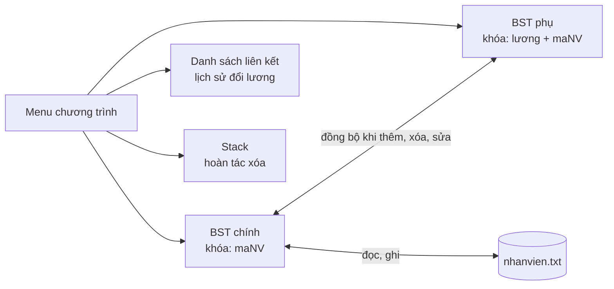

<div align="center">

# Hệ thống Quản lý Nhân sự & Bảng lương Cơ quan


*Quản lý hồ sơ nhân sự và tính lương thực lĩnh, được xây dựng hoàn toàn bằng các cấu trúc dữ liệu tự cài đặt.*

</div>

---

## Mục lục

- [Giới thiệu](#giới-thiệu)
- [Thông tin nhóm thực hiện](#thông-tin-nhóm-thực-hiện)
- [Chức năng](#chức-năng)
- [Cấu trúc dữ liệu sử dụng](#cấu-trúc-dữ-liệu-sử-dụng)
- [Quy tắc tính lương](#quy-tắc-tính-lương)
- [Lưu trữ dữ liệu](#lưu-trữ-dữ-liệu)
- [Hướng dẫn cài đặt và biên dịch](#hướng-dẫn-cài-đặt-và-biên-dịch)
- [Hướng dẫn sử dụng](#hướng-dẫn-sử-dụng)
- [Đánh giá độ phức tạp](#đánh-giá-độ-phức-tạp)
- [Hạn chế và hướng phát triển](#hạn-chế-và-hướng-phát-triển)

---

## Giới thiệu

Đây là chương trình console viết bằng **C++**, giúp cơ quan quản lý hồ sơ nhân sự và tính bảng lương hằng tháng. Điểm nhấn của dự án là việc **tự cài đặt và phối hợp nhiều cấu trúc dữ liệu** (cây nhị phân tìm kiếm, danh sách liên kết, ngăn xếp) để giải quyết một bài toán thực tế, thay vì dùng sẵn thư viện STL.

**Chương trình cho phép:**

- Thêm, tìm, sửa, xóa hồ sơ nhân viên.
- Tính lương thực lĩnh từ hệ số lương, ngày công, giờ làm thêm (OT), phụ cấp và số ngày đi trễ.
- Thống kê lương, tổng quỹ lương và xếp loại KPI theo ngày công.
- Theo dõi lịch sử thay đổi lương và hoàn tác thao tác xóa nhầm.
- Tự động lưu và nạp dữ liệu từ file văn bản, không mất dữ liệu khi thoát chương trình.

---

## Thông tin nhóm thực hiện

| Họ và tên | Mã số sinh viên | Vai trò |
|-----------|-----------------|---------|
| *Điền họ tên* | *Điền MSSV* | *Điền vai trò* |
| *Điền họ tên* | *Điền MSSV* | *Điền vai trò* |

**Giảng viên hướng dẫn:** *Điền tên giảng viên*

---

## Chức năng

| STT | Chức năng | Mô tả |
|:---:|-----------|-------|
| 1 | Thêm nhân viên | Nhập đầy đủ thông tin, mã nhân viên không được trùng |
| 2 | Tìm theo mã NV | Tìm kiếm nhanh trên cây BST |
| 3 | Tìm theo mức lương tối thiểu | Liệt kê nhân viên có lương thực lĩnh từ mức nhập vào trở lên, kết quả tăng dần theo lương |
| 4 | Xóa nhân viên | Xử lý đủ 3 trường hợp xóa node (lá, một con, hai con) |
| 5 | Cập nhật thông tin | Sửa thông tin, chấm công, OT, đi trễ; tự ghi lịch sử nếu lương thay đổi |
| 6 | In danh sách | Xuất toàn bộ nhân viên tăng dần theo mã (duyệt LNR) |
| 7 | Thống kê lương | Lương trung bình, cao nhất, thấp nhất |
| 8 | Lịch sử thay đổi lương | Xem lương cũ và lương mới (mới nhất hiển thị trước) |
| 9 | Xếp loại KPI | Sắp xếp theo ngày công giảm dần và xếp loại A/B/C/D |
| 10 | Tổng quỹ lương tháng | Tổng lương phải trả và tổng tiền đã trừ do đi trễ |
| 11 | Hoàn tác xóa | Khôi phục nhân viên bị xóa gần nhất |
| 12 | Lưu dữ liệu ngay | Ghi dữ liệu xuống file |
| 0 | Lưu và thoát | Lưu dữ liệu, giải phóng bộ nhớ rồi thoát |

**Xếp loại KPI theo ngày công**

| Loại | Điều kiện |
|:----:|-----------|
| **A** | Từ 26 ngày công trở lên |
| **B** | Từ 22 đến 25 ngày công |
| **C** | Từ 16 đến 21 ngày công |
| **D** | Dưới 16 ngày công |

---

## Cấu trúc dữ liệu sử dụng



| Cấu trúc | Vai trò trong chương trình |
|----------|----------------------------|
| **BST chính** (khóa là `maNV`) | Lưu hồ sơ nhân viên; thêm, tìm, xóa theo mã; duyệt LNR để in danh sách có thứ tự |
| **BST phụ** (khóa là cặp `lương, maNV`) | Tìm nhân viên theo mức lương nhanh, không cần duyệt toàn bộ cây chính. Luôn được đồng bộ với BST chính |
| **Danh sách liên kết đơn** | Lưu lịch sử thay đổi lương (`LichSuLuong`), thêm vào đầu danh sách |
| **Ngăn xếp (Stack)** | Lưu các nhân viên đã xóa để hoàn tác theo nguyên tắc vào sau ra trước (LIFO) |
| **Mảng động** | Dùng tạm khi xếp loại KPI (thu thập từ cây rồi sắp xếp theo ngày công) |

**Thông tin lưu cho mỗi nhân viên:** mã nhân viên, họ tên, chức vụ, phòng ban, hệ số lương, phụ cấp, số ngày công, số giờ OT, lương cơ bản và số ngày đi trễ.

---

## Quy tắc tính lương

```text
Lương theo hệ số = Hệ số lương × Lương cơ bản
Lương ngày công  = Lương theo hệ số × Số ngày công / 26
Lương OT         = (Lương theo hệ số / 26 / 8) × 1.5 × Số giờ OT
Tiền trừ đi trễ  = Số ngày đi trễ × 50.000 VND

Lương thực lĩnh  = Lương ngày công + Phụ cấp + Lương OT − Tiền trừ đi trễ
```

| Hằng số | Giá trị | Tên trong code |
|---------|---------|----------------|
| Ngày công chuẩn của tháng | 26 ngày (8 giờ mỗi ngày) | |
| Hệ số làm thêm giờ | 1.5 | `HE_SO_OT` |
| Mức trừ mỗi ngày đi trễ | 50.000 VND | `TIEN_TRU_MOT_NGAY_TRE` |

> **Lưu ý:** lương thực lĩnh không bao giờ âm. Nếu kết quả tính ra nhỏ hơn 0 thì chương trình lấy bằng 0.

**Ví dụ minh họa**

Nhân viên có hệ số lương 3.00, lương cơ bản 5.000.000 VND, đi làm 26 ngày, OT 4 giờ, phụ cấp 500.000 VND, đi trễ 1 ngày:

| Khoản | Cách tính | Kết quả (VND) |
|-------|-----------|--------------:|
| Lương theo hệ số | 3.00 × 5.000.000 | 15.000.000 |
| Lương ngày công | 15.000.000 × 26 / 26 | 15.000.000 |
| Lương OT | 15.000.000 / 26 / 8 × 1.5 × 4 | 432.692 |
| Phụ cấp | | 500.000 |
| Tiền trừ đi trễ | 1 × 50.000 | − 50.000 |
| **Lương thực lĩnh** | | **15.882.692** |

---

## Lưu trữ dữ liệu

Dữ liệu được lưu trong file `nhanvien.txt` cùng thư mục với chương trình. Mỗi nhân viên là một dòng, các trường cách nhau bằng dấu `|`:

```text
maNV|hoTen|chucVu|phongBan|heSo|phuCap|ngayCong|gioOT|luongCoBan|ngayTre
```

Ví dụ một dòng dữ liệu:

```text
NV001|Nguyen Van A|Truong phong|Ke toan|3.00|500000|26|4.00|5000000|1
```

- Chương trình tự nạp file khi khởi động và tự lưu sau mỗi thao tác thêm, xóa, sửa, hoàn tác, cũng như khi thoát.
- Đọc được cả file định dạng cũ (8 trường, không có chức vụ và số ngày đi trễ).
- Dữ liệu ghi theo thứ tự NLR để khi nạp lại, cây BST giữ nguyên hình dạng.
- Ký tự `|` trong dữ liệu nhập vào được tự đổi thành `-` để không làm hỏng file.

---

## Hướng dẫn cài đặt và biên dịch

### Yêu cầu hệ thống

| Hạng mục | Yêu cầu |
|----------|---------|
| Hệ điều hành | Windows, Linux hoặc macOS |
| Trình biên dịch | Hỗ trợ **C++11** trở lên (khuyến nghị g++ 7.0+) |
| Thư viện ngoài | Không cần, chỉ dùng thư viện chuẩn của C++ |

### Bước 1. Cài trình biên dịch

<details>
<summary><b>Windows</b></summary>

&nbsp;

- **Cách 1:** cài [MinGW-w64](https://www.mingw-w64.org/) hoặc [MSYS2](https://www.msys2.org/), sau đó thêm thư mục `bin` của MinGW vào biến môi trường `PATH`.
- **Cách 2:** cài IDE có sẵn trình biên dịch như **Dev-C++** hoặc **Code::Blocks** (bản có MinGW).
- **Cách 3:** cài **Visual Studio** và chọn workload *Desktop development with C++*.

</details>

<details>
<summary><b>Linux (Ubuntu / Debian)</b></summary>

&nbsp;

```bash
sudo apt update
sudo apt install build-essential
```

</details>

<details>
<summary><b>macOS</b></summary>

&nbsp;

```bash
xcode-select --install
```

</details>

### Bước 2. Tải mã nguồn

```bash
git clone <đường-dẫn-repository>
cd <tên-thư-mục-dự-án>
```

Hoặc đặt file `BTLCAUTRUC.cpp` vào một thư mục riêng trên máy.

### Bước 3. Kiểm tra trình biên dịch

```bash
g++ --version
```

Nếu lệnh in ra thông tin phiên bản thì môi trường đã sẵn sàng.

### Bước 4. Biên dịch

**Bằng g++ (Windows, Linux, macOS):**

```bash
g++ -std=c++11 -Wall -O2 BTLCAUTRUC__2_.cpp -o quanlynhansu
```

**Bằng Visual Studio (Developer Command Prompt):**

```bat
cl /EHsc /std:c++14 BTLCAUTRUC.cpp /Fe:quanlynhansu.exe
```

**Bằng IDE (Dev-C++ / Code::Blocks):**

1. Mở file `BTLCAUTRUC.cpp`.
2. Bật chuẩn C++11 trong cài đặt trình biên dịch (Dev-C++: *Tools → Compiler Options → Settings → Code Generation → Language standard = ISO C++11*).
3. Nhấn **F11** (Dev-C++) hoặc **F9** (Code::Blocks) để biên dịch và chạy.

### Bước 5. Chạy chương trình

```bash
# Linux / macOS
./quanlynhansu

# Windows (CMD hoặc PowerShell)
quanlynhansu.exe
```

### Lưu ý khi sử dụng

- Chạy chương trình ngay trong thư mục chứa file thực thi để `nhanvien.txt` được đọc và ghi đúng chỗ.
- Luôn thoát bằng chức năng **0. Lưu và thoát** để dữ liệu được lưu đầy đủ.
- Có thể sao lưu dữ liệu bằng cách sao chép file `nhanvien.txt`.
- Giao diện không dùng ký tự có dấu nên hiển thị tốt trên mọi terminal, không cần cấu hình bảng mã.

<details>
<summary><b>Xử lý lỗi thường gặp</b></summary>

&nbsp;

| Lỗi | Nguyên nhân và cách khắc phục |
|-----|-------------------------------|
| `'g++' is not recognized...` | Chưa cài g++ hoặc chưa thêm vào `PATH`. Cài MinGW và thêm thư mục `bin` vào `PATH` |
| `'stod' was not declared in this scope` | Chưa bật chuẩn C++11. Thêm tùy chọn `-std=c++11` khi biên dịch |
| `Khong mo duoc file de ghi!` | Thư mục đang chạy không có quyền ghi. Chạy ở thư mục khác hoặc cấp quyền ghi |
| Dữ liệu không còn sau khi mở lại | Đang chạy ở thư mục khác nên đọc nhầm `nhanvien.txt`. Chạy lại đúng thư mục chứa file dữ liệu |

</details>

---

## Hướng dẫn sử dụng

Khi khởi động, chương trình hiển thị menu điều khiển. Nhập số tương ứng với chức năng rồi nhấn Enter.

```text
============================================================
       CONTROL PANEL - QUAN LY NHAN VIEN & BANG LUONG
============================================================
 1. Them nhan vien
 2. Tim nhan vien theo ma NV
 3. Tim nhan vien theo muc luong toi thieu
 4. Xoa nhan vien
 5. Cap nhat thong tin / cham cong / OT / di tre
 6. In danh sach nhan vien (tang dan theo ma)
 7. Thong ke luong trung binh, cao nhat, thap nhat
 8. In lich su thay doi luong
 9. Xep loai KPI theo ngay cong (cao den thap)
10. Thong ke tong quy luong thang (va tong tien tru di tre)
11. Hoan tac xoa nhan vien gan nhat
12. Luu du lieu ngay
 0. Luu va thoat
------------------------------------------------------------
```

**Giới hạn dữ liệu nhập** (nhập sai chương trình sẽ yêu cầu nhập lại):

| Trường | Khoảng hợp lệ |
|--------|---------------|
| Hệ số lương | 0.1 – 100 |
| Phụ cấp | 0 – 100.000.000 |
| Số ngày công | 0 – 31 |
| Số giờ OT | 0 – 200 |
| Lương cơ bản | 1 – 1.000.000.000 |
| Số ngày đi trễ | 0 – số ngày công |

---

## Đánh giá độ phức tạp

| Thao tác | Độ phức tạp | Ghi chú |
|----------|:-----------:|---------|
| Thêm, tìm, xóa theo mã | O(h) | h là chiều cao cây; trung bình O(log n), xấu nhất O(n) vì cây không tự cân bằng |
| Tìm theo mức lương | O(h + k) | k là số kết quả tìm được |
| In danh sách, thống kê | O(n) | Duyệt toàn bộ cây |
| Xếp loại KPI | O(n²) | Dùng sắp xếp đổi chỗ đơn giản |

---

<div align="center">

**Hệ thống Quản lý Nhân sự & Bảng lương Cơ quan**

Bài tập lớn môn Cấu trúc dữ liệu và giải thuật

</div>
